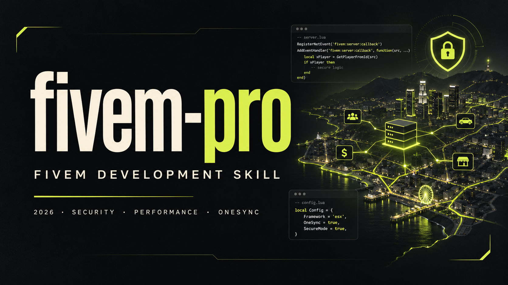

<div align="center">

# fivem-pro

**The all-in-one FiveM development skill for AI coding assistants.**

`Lua` · `QBCore` · `ESX` · `QBox` · `ox ecosystem` · `NUI` · `Deployment` · `Security` · `Mapping`

[](LICENSE)


[](https://github.com/leminhhuy113/fivem-pro/actions/workflows/lint.yml)

</div>

---

## 🎯 What is this?

`fivem-pro` teaches your AI assistant to build FiveM resources **the right way** —
from the first Lua event to a hardened, production-ready server.
One skill, sixteen domains, zero guesswork.

## ✨ What's inside

| | Domain | What the assistant learns |
|---|---|---|
| 🔧 | **Lua** | Trust boundaries, events, exports, threads, StateBags, natives |
| 🧩 | **QBCore** | Player object, callbacks, jobs, gangs, economy rules |
| 🟠 | **ESX** | xPlayer, callbacks, society, accounts |
| ⬛ | **QBox** | QBox patterns + QBCore→QBox migration |
| 📦 | **ox ecosystem** | ox_lib, oxmysql, ox_inventory, ox_target patterns |
| 🖥️ | **NUI** | Vanilla + React, focus lifecycle, CEF gotchas |
| 🚀 | **Deployment** | server.cfg, txAdmin, artifacts, multi-base layouts |
| ⚡ | **Live workflow** | Minimal restarts while the server keeps running |
| 📈 | **Performance** | resmon profiling, tick budget, entity/streaming optimization |
| 🧪 | **Testing** | Test discipline, staging flow, pre-deploy checklist |
| 🔁 | **CI/CD** | GitHub Actions: lint, format check, auto-release |
| 🩺 | **Troubleshooting** | Symptom → cause → fix FAQ |
| 🛡️ | **Security** | Anticheat hardening, detection patterns, exploit case studies, audit checklist |
| 🗺️ | **Mapping** | MLO / interior creation with Sollumz + CodeWalker |
| 🧭 | **Platform 2026** | Lua 5.4 defaults, OneSync, state bags, Enhanced-era compatibility |
| 🤝 | **Framework parity** | The same server-authoritative reward flow for QBCore, ESX and QBox |

Plus: `CHEATSHEET.md` (one-page quick reference) and `examples/template-resource/`
(a minimal secure resource demonstrating every Iron Rule).

## 🚀 Install

**Codex / Claude Code / Cursor** — copy the folder into the assistant's skills directory:

```bash
cp -r fivem-pro ~/.claude/skills/

# or per-project:
cp -r fivem-pro /path/to/project/.claude/skills/
```

For Codex, use `~/.codex/skills/`; for Cursor, use the workspace skill directory
configured by your team. Restart or reload the assistant after installation.

## ⚡ Choose your path

- **Building a resource?** Start with [`docs/quickstart.md`](docs/quickstart.md).
- **Auditing event abuse?** Read [`references/security.md`](references/security.md).
- **Supporting QBCore, ESX or QBox?** Compare the same secure turn-in flow in
  [`references/framework-parity.md`](references/framework-parity.md).
- **Checking a platform claim?** Consult the dated primary-source registry in
  [`references/sources.md`](references/sources.md).

### Interactive skill hub

[`docs/index.html`](docs/index.html) is a responsive, zero-build interactive
landing page for the skill. It includes one-click install-command copying,
keyboard-accessible navigation, a light/dark theme switch and a compact domain
map. It is deployed automatically to GitHub Pages after changes under `docs/`.

## ✨ 2026 platform update

The skill now reflects current Cfx guidance rather than treating old patterns as
defaults:

- **Lua 5.4 is already the runtime.** New manifests should omit the deprecated
  `lua54 'yes'` flag.
- **OneSync is the baseline for server-aware state.** Perform player iteration
  and authority checks server-side; do not assume every player or entity exists
  on a client's machine.
- **State bags are shallow.** Use flat, namespaced keys and choose replication
  deliberately. For sensitive state, enable `sv_stateBagStrictMode true` only
  after compatibility testing.
- **Network IDs cross machines; entity handles do not.** Validate scope and
  existence before resolving a net ID client-side.

See [`references/platform-2026.md`](references/platform-2026.md) for the
implementation notes and links to the corresponding Cfx documentation.

## ✅ Trust and maintenance

- Releases include a ready-to-install ZIP with one `fivem-pro/` top-level folder.
- CI validates Lua formatting/linting and checks local documentation links.
- Vulnerabilities go through [private reporting](SECURITY.md); contribution,
  support and community expectations are documented in
  [CONTRIBUTING.md](CONTRIBUTING.md), [SUPPORT.md](SUPPORT.md) and
  [CODE_OF_CONDUCT.md](CODE_OF_CONDUCT.md).

## 🧠 The Iron Rules

Everything this skill produces follows four rules:

1. **Client is never trusted** — validate every payload server-side, derive the actor from `source`.
2. **Explicit manifests** — fxmanifest load order is deliberate, no magic.
3. **No busy loops** — `Wait()` your threads, respect the tick budget.
4. **Clean NUI lifecycle** — focus in, focus out, cleanup on resource stop.

## 🗺️ Skill map

```
fivem-pro/
├── SKILL.md              # router + iron rules + triage
├── README.md
├── LICENSE
├── CHANGELOG.md
├── CHEATSHEET.md         # one-page quick reference
├── SECURITY.md            # private vulnerability reporting policy
├── selene.toml           # FiveM-aware Lua lint config
├── .github/workflows/
│   └── lint.yml          # CI: selene + StyLua on PRs
├── docs/
│   ├── index.html         # interactive skill hub / GitHub Pages
│   └── quickstart.md      # task-oriented entry points
├── examples/
│   ├── template-resource/  # minimal secure resource (every Iron Rule demoed)
│   └── secure-turn-in-resource/ # runnable QBCore / ESX / QBox turn-in example
└── references/
    ├── lua.md            # FiveM Lua conventions
    ├── qbcore.md         # QBCore framework patterns
    ├── esx.md            # ESX framework patterns
    ├── qbox.md           # QBox patterns + migration
    ├── ox-ecosystem.md   # ox_lib / oxmysql / ox_inventory / ox_target
    ├── nui.md            # NUI development (vanilla + React)
    ├── deployment.md     # FXServer deployment
    ├── workflow.md       # live resource workflow
    ├── performance.md    # resmon profiling + optimization
    ├── testing.md        # test discipline + pre-deploy checklist
    ├── cicd.md           # GitHub Actions for FiveM resources
    ├── troubleshooting.md # symptom → cause → fix FAQ
    ├── security.md       # anticheat + detection + exploit cases + audit
    ├── maps-sollumz.md   # map / MLO creation
    ├── platform-2026.md  # current Cfx platform compatibility notes
    ├── framework-parity.md # QBCore / ESX / QBox secure-flow comparison
    └── sources.md        # primary-source registry and freshness date
```

## 🤝 Contributing

Issues and PRs are welcome. Keep additions framework-agnostic where possible —
and defensive: this skill is about **building** servers, not breaking them.
Read [CONTRIBUTING.md](CONTRIBUTING.md) for the safety, source and validation
requirements, or use the issue and pull-request templates included in `.github/`.

## 📦 Releases

Pushing a tag that starts with `v` (for example `v1.2.0`) creates a ready-to-
install ZIP and attaches it to a GitHub Release. The archive has one top-level
`fivem-pro/` directory so it can be extracted straight into a skills folder.

## 📄 License

MIT — written from scratch by **1MS Studio**. See [LICENSE](LICENSE).


